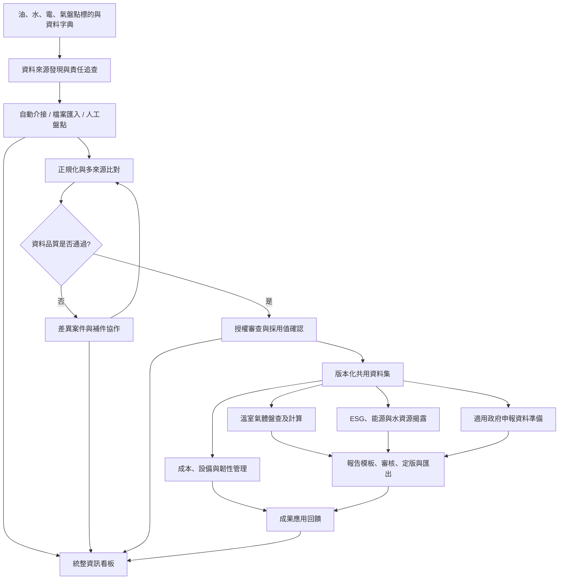
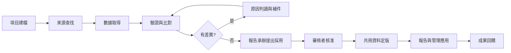
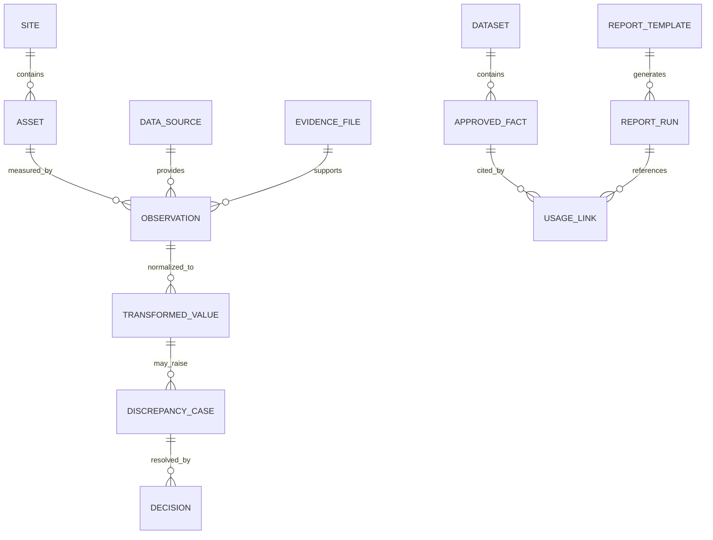

# 醫院油、水、電、氣資料盤點與治理平台

> 全新改版系統規劃書／產品需求文件（PRD）＋系統設計基準（SDD）  
> 版本：V1.0　日期：2026-11-15  
> 適用對象：醫院、院區、分院及跨院區管理組織  
> 建置原則：**一次建置完整能力、分步實施與驗收，不將已列需求當作未來擴充**

---

## 0. 文件定位與資料依據

本文件是「從既有碳盤查資料收集表單重新設計完整平台」的產品與工程規格，不是將現有 Excel 網頁化，也不是只有碳排量計算器。

**使用者提供的參考資料：**

1. `碳盤查資料收集表單.xlsx`：工作表「碳排放活動數據」，範圍 A1:F36，含範疇一至三、類別一至五及約 32 項活動來源，涉及公務車燃油、天然氣與 LPG、空調／冰水主機、緊急發電機、外購電力、電力與水上游排放、污水處理等。
2. `碳盤查資料_盤點與成果應用示範.xlsx`：保留原始工作表，增加「盤點項目索引」「盤點成果應用」「承辦查找與回饋指引」，提供資料尋找及成果關聯的初步概念。

**本案改版邊界：**以「油、水、電、氣」為主要操作入口；其餘碳盤查活動（如員工通勤、商務旅行、廢棄物、資本財）保留為可引用的既有盤查項目與資料關聯，**不能錯誤塞入油水電氣**，亦不代表本案已完成完整範疇三盤查。

**重要區分：**本文件中「應實作」為系統需求；「可能應用」為候選使用情境；「法定申報」需先依醫院組織類型、公告對象、用能門檻、申報年度與所採制度判斷，不自動認定所有醫院都有相同義務。

---

## 1. 專案願景與改版目標

### 1.1 核心定位

建立一套以**盤點標的與原始證據**為中心、跨單位共用的「醫院油水電氣資料治理平台」，讓一線執行者可以尋找、登錄、確認及維護資料；報告承辦可以追溯數據來源、處理差異、確認採用數值並產製報告；管理者與全院同仁則可看見進度、缺漏及成果應用。

### 1.2 從舊模式走向新模式

| 項目 | 舊模式：填報導向 | 新模式：資料治理與成果導向 |
|---|---|---|
| 工作起點 | 報告需要哪些欄位 | 醫院有哪些盤點標的及資料 |
| 找資料 | 先指定部門，再要求填表 | 先找設備、帳單、電號、契約、系統，再確認保管者 |
| 資料取得 | 單一 Excel 或人工填寫 | 自動介接、檔案匯入、人工盤點並行 |
| 數據衝突 | 人工自行調整 | 系統發現差異、說明原因、授權裁決 |
| 保存方式 | 每年一份新檔案 | 持續維護的標的、時間序列、證據與版本 |
| 報告用途 | 一張表對一份報告 | 同一來源支援多個制度、報告與管理工作 |
| 進度透明 | 私下追問填報人 | 統一看板、缺漏列管、歷程追蹤 |
| 第一線回饋 | 交資料就結束 | 看見資料被哪些成果採用及產生的效益 |

### 1.3 必須達成的八個業務目標

1. **不依賴已知部門**：未知權責人時也能先建檔、查找、追蹤。
2. **一物一碼、一來源一碼**：電號、水號、油槽、電表、氣表、設備及文件可唯一識別並防止重複盤點。
3. **同一期間多源對照**：保留各筆觀測值、單位、計量邊界、時間、證據及品質狀態。
4. **採用值可追溯**：報告承辦可對每一結論說明「為何採用、誰決定、何時決定」。
5. **報告定版不回寫原始資料**：已核准報告以固定快照重現；來源日後更新不悄悄改變已發行結果。
6. **一筆資料、多重應用**：避免不同報告要求第一線重複索資。
7. **共同看板、分級可見**：院內可見適度彙總進度，敏感金額、原始文件與個資不得公開。
8. **完整後台可配置**：盤點項目、驗證規則、門檻、欄位、單位、係數、報告模板、通知及權限均可經後台管理並保留版本。

### 1.4 不應誤解的系統定位

- 「油水電氣」是**營運資料管理分類**，不等於溫室氣體盤查範疇一、二、三，也不等於 ISO 14064-1 類別一至六。
- 水的取用量、電費及天然氣費用是**活動／營運數據**，不是直接的溫室氣體排放量；需要依適用方法、係數及邊界計算。
- 「資料已取得」不等於「資料可被盤查採用」；「設備銘牌照片已取得」不等於「逸散量已完成量化」。
- 「候選資料保管者」不等於「確認責任單位」。
- 申報檔匯出不等於已向政府官方平台正式申報；未取得官方 API 授權前不得宣稱自動申報。

---

## 2. 系統全貌與模組



### 2.1 完整功能模組（本次改版範圍）

| 代碼 | 模組 | 核心能力 |
|---|---|---|
| M01 | 組織與院區管理 | 集團／醫院／分院／建物／樓層／管理邊界、有效期間 |
| M02 | 油水電氣標的台帳 | 帳號、表計、設備、油槽、氣瓶、供應契約、標的異動 |
| M03 | 資料來源探索 | 未知負責人搜尋、候選線索、派工、詢問、轉交 |
| M04 | 資料蒐集 | API、排程、批次檔、OCR 輔助、人工登錄、行動盤點 |
| M05 | 來源與證據庫 | 原始檔、附件、雜湊、來源、時間、權限、歷程 |
| M06 | 數據品質與比對 | 單位正規化、時間對齊、重複判斷、平衡核對、差異案件 |
| M07 | 承辦協作與簽核 | 補件、裁決、退回、核准、異動單、代理、逾期提醒 |
| M08 | 共用資料與採用值 | 原始觀測值、核准值、有效版本、依用途選取資料集 |
| M09 | 排放與營運計算 | 版本化排放係數、轉換係數、能源與用水 KPI、計算溯源 |
| M10 | 報告應用與產製 | GHG、ESG、能源、水管理、適用申報模板與匯出 |
| M11 | 統整資訊看板 | 可見範圍、完成率、差異、趨勢、成果引用與阻塞 |
| M12 | 成果回饋中心 | 「我提供的資料被誰使用」與引用紀錄 |
| M13 | 系統管理後台 | 權限、字典、門檻、模板、年度、通知、整合、稽核 |
| M14 | 歷史資料移轉 | 既有 Excel 匯入、欄位對照、錯誤回報、去重與回溯 |

---

## 3. 使用角色與權責

同一個人可以同時擔任多個角色；權限依「組織範圍＋標的範圍＋操作動作」判斷，不應只依部門名稱決定。

| 角色 | 主要工作 | 主要畫面 | 不應自動擁有的權限 |
|---|---|---|---|
| 盤點承辦 | 建檔、找來源、取證、更新、回覆異常 | 盤點工作台 | 任意修改已核准採用值 |
| 資料保管者／設備管理員 | 提供帳單、紀錄、設備資訊，確認真實來源 | 資料提供與追查頁 | 對所有報告做最終裁決 |
| 報告承辦 | 建立報告需求、查證、比對、選取採用值、草擬報告 | 報告工作台 | 無限制改寫原始證據 |
| 資料審核者 | 核對差異及裁決理由，批准或退回 | 審核中心 | 刪除稽核日誌 |
| 報告核准者 | 核准對外報告／定版／簽核 | 報告簽核頁 | 任意改寫已封存版本 |
| 管理者 | 追蹤院區、部門與年度進度、資源協調 | 統整看板 | 透過公開看板取得敏感原始文件 |
| 一般同仁 | 瀏覽授權的進度與成果 | 公開進度看板 | 查看原始帳單、個資、密件 |
| 系統管理員 | 管理設定、規則、服務帳號、權限 | 管理後台 | 代替業務負責人認定資料正確性 |
| 稽核／查驗人員 | 依授權查閱證據鏈、報告快照與歷程 | 稽核檢視頁 | 直接覆寫業務資料 |

**治理原則：**未指派到某單位的盤點標的仍可存在，狀態標示「權責待確認」，由平台統籌窗口或指定協調人處理，不應阻止建檔。

---

## 4. 四個面向的盤點內容與資料口徑

### 4.1 油（OIL）：燃料、油槽、車輛與發電機

| 子項 | 最小盤點標的 | 典型數據與佐證 | 重要比對 | 應用 |
|---|---|---|---|---|
| 公務車汽柴油 | 車輛／油卡／車牌代碼 | 加油日期、油種、L、費用、里程、油單 | 油卡紀錄 vs 發票；里程與油耗 | 燃料管理、GHG、ESG、車隊汰換 |
| 緊急發電機柴油 | 發電機／共用油槽 | 儲槽存量、採購入庫、領用、試機、運轉時數 | 期初＋入庫－期末－其他用途 vs 發電機用量 | GHG、備援韌性、燃料庫存 |
| 鍋爐或機具燃油 | 設備／油槽／供應契約 | 油種、採購、補油、存量、流量 | 採購量與實耗量分開 | GHG、能源成本、設備效率 |
| 潤滑油及噴霧產品 | 產品／SDS／使用場所 | 採購、領用、成分、用途 | 確認是否屬相關排放活動，不以名稱推定 | 物料治理、適用時盤查 |

**油類特殊規則：**

- 購買量、領用量、消耗量、庫存變化、費用是不同指標，不可互相取代。
- 多台發電機共用油槽時，不可把同一槽補油量分別算給每台機器。
- 無獨立耗油計量時，可採核准的存量平衡或推估方法，並標示品質等級與不確定性。
- 維修試機、真實斷電、演練等運轉原因可分開管理，供韌性評估使用。

### 4.2 水（WATER）：取水、用水、排水、回收再利用

| 子項 | 最小盤點標的 | 典型數據與佐證 | 重要比對 | 應用 |
|---|---|---|---|---|
| 自來水 | 水號／總表／建物 | 水費帳單、m³、計費起迄、讀表值 | 水費 vs 總表；跨期比例分攤 | ESG 水資源、用水與成本管理 |
| 地下水等其他水源 | 取水設施／表計 | 依法或依實況記載之取水量 | 取水總量 vs 內部用量 | 水源管理、適用之申報 |
| 建物／科室用水 | 分表／部門／設備 | 分表讀值、流量 | 總表－分表合計＝未分配／管損等 | 異常檢測、節水規劃 |
| 污水與排水 | 排放口／污水處理設施 | 排水量、處理方式、檢測及委外紀錄 | 取水－排水－其他消耗，需考慮差異口徑 | 水揭露、污水管理、適用時 GHG |
| 回收再利用水 | 回收系統／表計 | 回收量、再利用量及用途 | 防止將重複循環量列為新取水量 | 節水績效、ESG |

**水類特殊規則：**

- 取水量（withdrawal）、排水量（discharge）及耗水量（consumption）必須分開存放，不能把自來水帳單直接視為耗水量。
- 水量與排放量（tCO₂e）不同。水或污水涉及排放時，應有獨立的量化方法和間接／直接排放分類。
- 污水是否自行處理、是否接管及相關設施是否存在，須先確認適用性。
- 水錶循環讀值、換表、回零、估抄與跨期帳單需有特殊處理規則。

### 4.3 電（ELECTRICITY）：外購、發電、儲能、配電及耗能設備

| 子項 | 最小盤點標的 | 典型數據與佐證 | 重要比對 | 應用 |
|---|---|---|---|---|
| 外購電力 | 台電電號／計費點 | kWh、費用、契約容量、計費期間、帳單 | 台電帳單 vs 電表／EMS，同期間同邊界 | GHG、ESG、能源申報、成本 |
| 院內分表 | 智慧表／變電站／建物 | 累積度數、需量、時段與電能品質 | 母表與子表層級、損失與未計量部分 | 用電結構、節能診斷 |
| 自發自用與售電 | 太陽能／其他發電系統 | 產電、自用、輸出、購電及憑證資料 | 避免同筆電量重複認列 | 再生能源管理、ESG |
| 儲能系統 | 儲能櫃／充放電表 | 充電 kWh、放電 kWh、SOC、損耗 | 充電與放電不可逕行互抵成組織用電 | 韌性、需量管理、用電調度 |
| 高耗能設備 | 空調、冰機、資訊機房等 | 運轉小時、功率、設備清冊、分表 | 設備推估 vs 表計用電 | ISO 50001、設備汰換 |

**電類特殊規則：**

- 計費區間不一定是自然月，系統須保存原期間及依規則分攤後的期間數據。
- 台電帳單、EMS、子表資料未必屬相同計量範圍；先校準邊界，才比較差異。
- 累積電表讀值要計算差分，並處理換表、歸零、缺點與表計倍率。
- 太陽能、儲能及憑證應建立不同記帳邏輯，不因名稱為綠電就自行減少組織排放量。

### 4.4 氣（GAS）：燃料氣、逸散氣體及相關設備

| 子項 | 最小盤點標的 | 典型數據與佐證 | 重要比對 | 應用 |
|---|---|---|---|---|
| 天然氣 | 瓦斯帳號／氣表／鍋爐 | 用量（m³等）、費用、計費期間、熱值（如需） | 氣費帳單 vs 表計 vs 鍋爐運轉 | GHG、能源管理、成本 |
| 液化石油氣（LPG） | 鋼瓶／儲槽／契約 | kg、桶數、重量、採購與庫存 | 採購 vs 領用 vs 庫存 | GHG、餐飲／設備能源 |
| 冷媒 | 空調、冰水主機、冰箱等設備 | 冷媒種類、充填容量、補充／回收量、維修單 | 銘牌與維修紀錄，不能只用銘牌推定當年度逸散量 | GHG 逸散、設備管理 |
| 氣體絕緣設備 | 氣體斷路器等 | 型式、絕緣氣體、補充／維修紀錄 | 確認是否使用相關溫室氣體；勿混淆 ACB 與 GCB | 適用時盤查、設備管理 |
| 醫療／工業氣體 | 氧氣、N₂O、CO₂ 等依用途區分 | 種類、購入、使用、回收或處理紀錄 | 不得假定所有醫療氣體的全部採購量都是排放量 | 供應管理、適用時排放量化 |
| 污水處理相關氣體 | 污水設備與處理流程 | 處理量、方法、設施條件 | 依方法判斷甲烷等，非由「水量 × 任意係數」推估 | 適用時 GHG |

**氣類特殊規則：**

- 「天然氣」、「冷媒」、「N₂O」、「CO₂」、「高壓開關氣體」是不同物理／業務類型，須有不同資料欄位及量化方法。
- 銘牌的充填容量是設備特徵，不等於年度排放量。
- 氧氣等非溫室氣體可列入供應與風險管理，但不可被系統自動列為溫室氣體排放。
- 涉及醫療氣體時，是否納入、如何量化，須依服務活動、實際使用及適用方法決定。

### 4.5 統一資料定義

所有油水電氣數據至少保存：

`組織ID、院區ID、盤點標的ID、資料型態、數值、原始單位、標準單位、測量期間起迄、資料來源ID、佐證ID、取得方式、取得時間、資料品質、版本、提交人、審查狀態`

另需依標的加上可選專屬欄位：電號、水號、氣號、車輛／設備資產碼、儲槽碼、表計倍率、冷媒種類、容積與庫存等。

---

## 5. 資料模型：先區分「標的、來源、觀測、採用、應用」

此五種紀錄不得設計成單一填報表欄位：

1. **盤點標的（Inventory Asset）**：到底在盤點誰或什麼？例：`A院區／台電電號 1234`。
2. **資料來源（Source）**：數據從哪裡來？例：台電帳單、EMS、人工抄表；保管者可未知。
3. **原始觀測值（Observation）**：誰在何時、透過何種方法取得什麼數字；不可直接覆寫。
4. **採用值（Approved Fact）**：經核准後，對某期間、某指標採用的值，保留原因和版本。
5. **成果引用（Usage Link）**：哪一份報告、圖表、申報資料或管理指標引用了哪個採用值版本。

### 5.1 計量粒度與唯一性

- 標的唯一鍵：`organization_id + site_id + asset_type + external_identifier + valid_from`；外部識別碼可加密或遮罩。
- 觀測值唯一性不是 `月份 + 標的`，因為同月可有多個來源、多個指標與多個期間版本。
- 推薦觀測語意鍵：`asset_id + metric_code + period_start + period_end + source_id + source_record_key + version`。
- 採用值唯一約束：同一**資料集版本＋盤點標的＋指標＋期間＋口徑**只能有一筆「目前有效採用值」，但必須保留歷次核准歷史。
- 計量範圍需有上下層關係：`總表 → 分表`、`共用油槽 → 多設備`，不允許在同一統計口徑下無條件相加。

### 5.2 兩條互相獨立的狀態軸

**盤點適用性：**`未判定 → 適用／不適用／待查證`。不適用須記錄原因及核准人。

**資料工作進度：**`待建檔 → 找來源中 → 已找到來源 → 蒐集中 → 待驗證 → 差異處理中 → 待審核 → 已核准 → 已定版`；另有 `退回補件`、`暫停／封存` 等狀態。流程可往返但必須留下事件紀錄。

**用途採用狀態：**`候選用途 → 評估適用 → 已對應欄位 → 已引用 → 已出報告／已完成申報資料準備`。不可把「已計畫引用」當成「實際已使用」。

---

## 6. 端到端操作流程（標準閉環）

### 6.1 建立盤點計畫

1. 設定組織、院區、盤點年度、期間、盤查／揭露邊界。
2. 套用油水電氣盤點模板，帶入項目、必要資料、預期頻率及候選來源。
3. 系統根據既有標的台帳產生任務；未知標的可由承辦新增。
4. 指定整體統籌人與審核規則；允許權責未定標的存在。

### 6.2 找不到負責人仍可作業

1. 輸入項目名稱或關鍵詞，例如「柴油」。
2. 系統回傳可能證據：加油單、設備資產清冊、油槽、採購契約、維修紀錄。
3. 依候選資料來源追查「提供或管理該筆文件的人」，建立詢問任務。
4. 若第一次洽詢失敗，移交統籌人協調；系統保留歷次洽詢、回覆和轉介關係。
5. 確認來源後建立保管者與資料種類關聯，但須記載生效日期；部門更動不丟失舊歷程。

### 6.3 蒐集與交叉比對

1. 取得自動資料、人工填寫及匯入檔。
2. 保留原始檔，將欄位對應到資料字典，進行單位轉換。
3. 檢查期間、邊界、標的是否一致，不可直接比較口徑不同資料。
4. 進行異常、重複與平衡核對，對衝突生成差異案件。
5. 盤點承辦解釋差異；必要時請來源保管者補件。

### 6.4 審查、核准與成果使用

1. 報告承辦看到各來源數值、佐證、差異、建議判定依據。
2. 可指定採用來源、經授權計算調整值，或退回補件。
3. 審核者批准，留下裁決人、理由、日期、影響範圍。
4. 形成固定版本資料集，供多種報告引用。
5. 報告定版後建立「資料 → 指標 → 報告」引用鏈。
6. 第一線及管理者看到完成進度與實際應用成果。



---

## 7. 盤點承辦工作台：完整畫面需求

### 7.1 主畫面

頂部顯示：`我的待辦｜本期已完成｜待找來源｜待補件｜差異案件｜已被採用成果`。

主要表格欄位：`面向、院區、盤點項目、標的名稱、期間、來源完整度、驗證狀態、資料保管者、最後更新、下一步、截止日`。

功能包含搜尋、批次派工、批次更新、篩選、Excel 匯入、CSV 匯出、地點／設備 QR Code、附件批次上傳、歷史沿用與異動比較。

### 7.2 新增／維護盤點標的畫面

**基本資訊：**油水電氣類別、子項、院區、建物位置、資產／帳號識別、計量邊界、是否共用、是否租賃、啟用／停用日期、照片、座標／樓層（可選）。

**負責及來源：**實際保管者（可空）、候選窗口、資料來源、取得方式、更新頻率、文件所在位置。

**數據規格：**指標、單位、讀值類型（區間用量／累積讀值／庫存／交易／推估）、統計期間、檢核規則。

**成果用途：**候選報告、候選管理指標與實際引用記錄。

**操作：**新增、儲存草稿、送出、補件、改派、複製歷史標的、停用、異動申請。

### 7.3 現場盤點畫面（行動裝置友善）

- 掃描設備／水電表 QR Code 或搜尋資產。
- 拍攝銘牌、表計、帳單及維修紀錄。
- 填寫讀值、單位、日期、表計倍率、設備狀態與備註。
- 檢查同地點、同編號、同時間是否重複。
- 支援網路不穩的暫存草稿與復原；恢復連線後確認上傳，不允許無提示衝突覆寫。
- 不將照片識別數字視為已核准數據；使用者須確認辨識結果。

### 7.4 使用者價值設計

在標的詳細頁永久顯示：`這項盤點已支援 3 項成果`，點入可見報告名稱、引用年度、引用指標和公開／內部核准的成果摘要。這是提升第一線參與感的核心功能，不可僅當成裝飾性徽章。

---

## 8. 報告承辦工作台：完整畫面需求

### 8.1 報告案件總覽

可新增報告案件並設定：報告類型、報告年度、組織邊界、採用規範與版次、所需指標、截止日、審核人與保密等級。系統自動依報告指標建立資料需求清單，並檢查目前資料可否引用。

### 8.2 資料來源與差異審查頁

同一指標同一期間顯示：

| 資料來源 | 取樣期間 | 原始值 | 正規化值 | 計量邊界 | 佐證 | 品質狀態 |
|---|---|---:|---:|---|---|---|
| 自動介接 | 10/01–10/31 | 102,450 kWh | 102,450 kWh | A棟主表 | API批次 | 待比對 |
| 帳單匯入 | 09/28–10/27 | 103,200 kWh | 尚待期間對齊 | 台電計費點 | PDF帳單 | 不可直接比較 |
| 人工登錄 | 10/01–10/31 | 102,800 kWh | 102,800 kWh | A棟現場讀值 | 照片 | 待確認 |

> 上表純示例。因帳單期間與自然月不一致，不能只看最大／最小差距，就判斷哪筆正確。

畫面必須支援：

- 左側「數據與差異」，右側「來源文件／表計紀錄」，並列檢視。
- 檢視原始、標準化、校正、採用四層數值；不得混成一個欄位。
- 顯示自動規則命中原因、差異百分比、絕對差、品質評級與可能根因。
- 查詢來源保管人，若未知可建立協查及補件任務。
- 採用指定來源、依核准規則合成採用值、判定不適用或退件。
- 裁決時強制填寫理由及證據連結；高影響裁決須雙人覆核。
- 顯示該筆數據已被哪些報告引用，避免修改後影響不明。

### 8.3 報告資料準備與產製畫面

左側顯示報告章節／欄位，中間顯示待使用的「已核准數據集」，右側顯示來源、計算式與佐證清單。所有缺漏／不適用／估計數據必須明示，不得用 `0` 替代空值。

基本功能：報告範本選擇、指標映射、計算與重算、趨勢圖、報告前稽核、審核簽核、PDF／DOCX／XLSX／CSV 匯出、報告封存及再現（同版輸入與係數得到同版結果）。

---

## 9. 統整資訊看板：全院可見，但資訊分級

### 9.1 看板分層

- **公開進度看板**：一般院內同仁可見的進度、盤點範圍、成果摘要，不含敏感財務及個資。
- **管理看板**：依授權顯示院區、單位、年度 KPI、成本及異常處理績效。
- **報告看板**：依報告案件顯示要求項目、缺漏、資料品質、封版進度。
- **設備與能源看板**：有權限者檢視耗能、耗水、用油、用氣、用量異常及趨勢。

### 9.2 KPI 定義，避免虛假的「完成率」

| 指標 | 建議公式／意義 | 特別注意 |
|---|---|---|
| 標的適用性確認率 | 已判定適用或不適用的標的 ÷ 待判定標的總數 | 不適用須經核准 |
| 來源定位率 | 已確認資料取得路徑的適用標的 ÷ 適用標的數 | 不需已知道部門才能建檔 |
| 資料取得率 | 已取得必要期間資料的資料需求數 ÷ 應取得資料需求數 | 數字存在不代表合格 |
| 驗證通過率 | 驗證通過的資料需求數 ÷ 已取得資料需求數 | 差異未結不可算完成 |
| 審核完成率 | 已核准資料需求數 ÷ 應審核資料需求數 | 已核准與已定版分開 |
| 報告就緒率 | 某報告所需且已達可引用狀態欄位數 ÷ 該報告適用欄位數 | 分母依版本化模板決定 |
| 差異待辦量 | 尚未結案差異案件數 | 分嚴重程度及逾期天數 |
| 成果實際引用數 | 已定版資料被報告／管理成果引用之次數 | 區分候選用途與實際引用 |

### 9.3 看板呈現

- 四類：油、水、電、氣完成率與本期重點。
- 多層：總院 → 分院／院區 → 建物／盤點標的。
- 依月份、年度、報告類型、責任人、來源種類、狀態篩選。
- 逾期任務、未知保管者、資料缺漏與高風險差異優先展示。
- 適度揭露「已完成成果」而不僅是「未完成名單」，讓承辦人看見自身貢獻。

---

## 10. 多來源數據蒐集與比對引擎

### 10.1 三種主要取得方式

| 來源型態 | 能力 | 控管要求 |
|---|---|---|
| 自動介接 | 台帳、EMS、智慧電表、已授權 API／SFTP／批次檔 | 斷線告警、失敗重試、游標／增量同步、時區與去重 |
| 檔案匯入 | Excel、CSV、ODS、PDF 帳單、歷史掃描檔 | 模板管理、欄位映射、預覽、錯誤清單、OCR 人工覆核 |
| 人工盤點 | 表計讀值、設備銘牌、油槽存量、氣瓶及冷媒維修 | 依標的表單、單位檢查、照片、建立人、取得時間 |

不可假設第三方政府平台、台電或水公司一定提供 API。應提供可接入的標準介面；是否可正式串接取決於授權、提供方能力及院方資安政策。沒有 API 時可透過合法匯入方式完成相同資料需求。

### 10.2 比對前置條件

每一組被比較數據需先符合以下條件，或明確說明對齊方法：

- 相同院區與計量邊界；
- 相同指標與可換算單位；
- 相同或可換算的時間區間；
- 相同數據語意（用量、費用、採購、領用、存量等）；
- 明確的母表／分表關係、表計倍率與換表事件；
- 排除重複匯入、重複附件、重覆使用同一來源產生的假獨立證據。

### 10.3 基本檢核規則

| 規則 | 用途 | 例外處理 |
|---|---|---|
| 必填與型別 | 檢查單位、數值、時間、來源 | 阻擋無效記錄 |
| 期間覆蓋 | 月／年缺漏、跨年度帳單 | 依規則分攤或要求補件 |
| 單位正規化 | L、kL、m³、kg、kWh 等 | 需記錄換算係數版本 |
| 同來源去重 | 同一帳單或 API 訊息重送 | 保留來源關聯及去重紀錄 |
| 橫向差異 | 同邊界、同期間跨來源比對 | 超門檻開差異案件 |
| 歷史異常 | 同比、環比、離群值 | 可標示季節性、營運量變動 |
| 平衡檢查 | 油品庫存、母子電表、水量平衡 | 不足以判錯時列為待解釋 |
| 越界檢查 | 負耗用、無效讀值、跳變 | 辨識換表、重置、回轉 |
| 証據完整性 | 是否有單據、照片、維修記錄 | 未達門檻不得提交最終審核 |

### 10.4 差異計算與裁決原則

對同口徑可比較數據，建議提供：

```text
絕對差 = |數值 A - 數值 B|
相對差 = 絕對差 / 參考值 × 100%
```

參考值來源與 0 分母處理需在後台明確設定，並同時判斷絕對差門檻及相對差門檻，避免小分母誇大異常。

**不得採用「多來源取平均」作為預設裁決方式。**裁決以計量範圍、來源可信性、原始文件、時間對齊、適用計算方法及人工覆核為依據。必要時產生校正／估算資料作為**衍生值**，絕不覆寫原始觀測。

### 10.5 異常案件生命週期

`自動發現／人工提報 → 分級 → 指派 → 調查 → 補件或提出採用方案 → 審核 → 結案 → 追蹤`。

每個案件需保存：差異型態、受影響標的、期間、數據、佐證、處理人、時效、決議、重新計算清單、衝擊報告。

---

## 11. 資料來源探索與組織知識庫

這是本案必備的差異化設計，不能只建立一個「負責部門」下拉選單。

### 11.1 尋找路徑

```text
盤點項目名稱
  → 可能設備／合約／帳單／系統
  → 可能來源的實際保存位置
  → 候選聯絡窗口
  → 詢問、轉介、查證
  → 確認目前保管者與替代窗口
  → 更新「資料來源知識庫」
```

### 11.2 保留的資訊

- 資料項目 → 常見證據與實際來源的關聯；
- 來源 → 組織、設備、帳號、檔案位置及系統介接；
- 來源 → 候選窗口、已驗證保管人、代理人及有效期間；
- 詢問紀錄 → 問誰、何時問、誰轉介、結果是什麼；
- 問題解法 → 去年怎麼找到、今年是否仍適用。

支援關鍵字搜尋、來源關聯檢索、建議路徑、歷史盤點經驗引用。人工或 AI 建議必須標註為「候選」，不能未經確認就成為組織責任分工。

---

## 12. 報告應用與欄位映射引擎

### 12.1 報告不是來源資料的擁有者

同一筆核准資料應由報告模板引用：

`核准用電量 → 能源使用總量`  
`核准用電量＋年度適用排放係數 → 電力相關排放量`  
`核准用電量＋適用分母 → 每床／每人次用電強度`  
`核准燃料用量 → 油氣能源管理、相關排放量`  
`核准取水與排水資料 → 水資源揭露與營運績效`

### 12.2 報告模板主檔

每種模板須設定：

`template_id、模板名稱、制度或準則、適用對象條件、適用起始／結束日期、報告年度、發布年度、版本、章節、欄位、資料型態、資料映射、必要性、計算式、審查規則、附件要求、匯出格式、狀態`。

至少提供下列模板**及可由後台調整的模板管理工具**：

1. 組織溫室氣體盤查：依採用的 ISO 14064-1／主管機關指引及盤查邊界配置。
2. ESG 永續報告書環境面：能源、水、排放、管理績效及佐證等資料表與文字段落。
3. ISO 50001 能源管理：能源績效指標、基線、改善專案與比較。
4. 適用之經濟部能源署能源用戶申報資料準備。
5. 適用之政府機關及學校節約能源填報資料準備。
6. 醫院自訂營運資料報告：水電費、發電機燃油、備援韌性、設備改善。
7. 溫室氣體盤查佐證清單、資料品質摘要及查核追蹤表。

上述兩種能源申報制度**不是同一個系統**，必須分開建模、分別確認對象與格式。

### 12.3 版次切換

- GRI 302：能源 2016 與 GRI 103：能源 2025、GRI 305 部分揭露與 GRI 102：氣候變遷 2025 之間有版本銜接；**2027-01-01 起發布相關報告需依新版適用規則檢查**。
- 依「報告發布日期＋採用準則＋模板版次」選擇正確版本，保留歷史報告可重現性。
- 排放係數、GWP、單位轉換、組織邊界、基準年及重算規則分別版控，不能僅改報告年份就重算成新口徑而不留痕跡。

### 12.4 報告發布流程

`建立案件 → 選擇版本／邊界 → 自動比對資料就緒度 → 補件／裁決 → 執行計算 → 預覽及人工覆核 → 審核簽核 → 定版封存 → 匯出／列印／對外提交（依實際授權） → 回饋資料提供者`。

報告封存須包含：資料集版本、公式版本、係數版本、使用者、核准歷程、結果檔雜湊與引用清單。只有具備可用官方申報介面及明確授權時才可實作提交；其餘情況提供官方格式或人工轉錄資料包，不以匯出檔案宣稱申報完成。

---

## 13. 數值計算、係數與可解釋性

### 13.1 一般計算鏈

```text
原始活動數據
→ 單位／期間／邊界轉換
→ 核准採用值
→ 指定年度與方法的排放／能源／水量係數
→ 計算結果
→ 報告欄位
→ 來源與公式的追溯鏈
```

### 13.2 計算引擎應支援

- 核准的排放係數法、經配置的其他適用量化方法、單位轉換與加權／分攤規則。
- 燃料 CO₂、CH₄、N₂O 等分項處理及 GWP 版本；冷媒及其他氣體的適用量化方法。
- 外購電力排放計算；適用時記錄不同的用電排放認列方法與憑證條件。
- 建立能源與水量 KPI：年總量、月趨勢、成本、單位營運量強度、差異與改善率。
- 分母（病床、樓地板面積、就診／住院人次等）應有獨立來源、定義及期間，不可隨意套用。
- 每個結果可「展開計算」：活動數據版本、係數來源／年度／有效日期、公式、四捨五入、結果。
- 禁止直接編輯封存結果；要修改必須建立變更案件及新版本。

### 13.3 設定值管理

所有數值設定均由後台管理：排放係數、熱值、GWP、換算倍率、差異門檻、歷史波動門檻、報告指標、比較年度、精度、提醒期限、核准層級。每項設定具 `版本、有效日期、來源、修改人、核准人、修改原因`，不得悄悄更新歷史計算。

---

## 14. 資料庫與實體關係

### 14.1 建議資料表

| 資料表 | 重要欄位 | 目的 |
|---|---|---|
| organizations / sites / buildings | id、parent_id、valid_from/to | 組織及地點階層 |
| users / roles / grants | user_id、role、scope、action | 分層授權 |
| inventory_items | id、domain、subtype、applicability | 盤點項目定義 |
| assets | id、site_id、asset_type、external_key、parent_asset_id | 表計／油槽／設備實體 |
| asset_history | asset_id、change_type、effective_at | 設備與權責歷程 |
| data_sources | id、source_type、owner_status、location | API、文件或人工來源 |
| source_contacts | source_id、contact_id、valid_from/to | 可未知且可變動的保管者 |
| evidence_files | id、hash、mime、storage_key、confidentiality | 原始佐證不可變儲存 |
| observations | id、asset_id、metric_id、period、value、unit、source_id | 原始多來源數值 |
| transformed_values | id、observation_id、rule_version、value | 正規化及期間分攤 |
| validation_runs | id、ruleset_version、status、run_at | 機器檢核紀錄 |
| discrepancy_cases | id、affected_keys、severity、owner、status | 差異案件 |
| decisions | id、case_id、selected_value、reason、reviewer | 裁決及覆核 |
| approved_facts | id、dataset_version、asset_id、metric、period、value | 可重現採用值 |
| datasets / snapshots | id、boundary_id、version、hash、locked_at | 封版資料集 |
| calculation_rules / factors | id、version、validity、source | 計算規則與係數 |
| calculated_indicators | id、dataset_id、rule_version、value | 派生指標 |
| report_templates / mappings | id、standard、version、field、metric | 報告模板與欄位映射 |
| report_runs / report_artifacts | id、snapshot_id、file_hash、status | 報告產製和封存 |
| usage_links | fact_id、report_id、field_id、used_at | 成果引用鏈 |
| tasks / comments / notifications | target_id、assignee、due、status | 協作通知 |
| integrations / sync_jobs | connector、cursor、status、error | 資料介接及排程 |
| configuration_versions | key、value、effective_at、approved_by | 後台版控 |
| audit_events | actor、action、target、before/after、timestamp | 不可任意刪改的稽核歷程 |

### 14.2 資料關聯示意



**實際落地補充：**ER 為概念性關聯，實作應加入複合唯一鍵、時間區間約束、來源檔版本、租戶隔離、物件儲存參照、軟刪除及稽核事件；長時間序列可分區儲存。

---

## 15. 系統選單與畫面資訊架構

```text
首頁
├─ 我的工作台
│  ├─ 我的盤點任務
│  ├─ 待找資料來源
│  ├─ 待補件與待回覆
│  ├─ 數據差異案件
│  └─ 我的盤點成果與引用
├─ 油／水／電／氣盤點管理
│  ├─ 盤點項目與模板
│  ├─ 設備／表計／帳號台帳
│  ├─ 資料來源與保管者追查
│  ├─ 自動介接／Excel匯入／人工盤點
│  ├─ 數據檢視與版本
│  └─ 佐證文件庫
├─ 數據品質中心
│  ├─ 檢核規則與執行結果
│  ├─ 多源對照
│  ├─ 差異案件與裁決
│  └─ 採用值／資料集定版
├─ 報告與成果
│  ├─ 報告案件
│  ├─ 報告模板與欄位映射
│  ├─ 排放量／營運指標計算
│  ├─ 審核與簽核
│  ├─ 報告匯出及封存
│  └─ 成果應用回饋
├─ 統整資訊看板
│  ├─ 全院公開進度
│  ├─ 院區與單位進度
│  ├─ 油水電氣趨勢
│  └─ 報告準備與成果應用
└─ 系統管理
   ├─ 組織及權限
   ├─ 資料字典／計量邊界
   ├─ 來源／介接管理
   ├─ 門檻、係數與版本
   ├─ 模板、截止日與通知
   ├─ 歷史資料移轉
   └─ 稽核日誌與備份
```

### 15.1 四種主要畫面線框（文字）

**A. 盤點承辦：**

```text
┌─────────────────────────────────────────────────────────────┐
│ 我的盤點工作台  [院區] [年度] [油/水/電/氣]    [+新增標的] │
├─────────┬──────────┬──────────┬──────────┬──────────────┤
│ 來源待找│ 待補資料 │ 待驗證   │ 已核准   │ 成果已被引用 │
├─────────┴──────────┴──────────┴──────────┴──────────────┤
│ 搜尋設備、電號、水號、資料名稱      [匯入] [人工盤點]     │
│ 電 / A院 / 主電號 / 2026年10月 / 待驗證   [查看比對]       │
│ 油 / A院 / 柴油槽 / 2026年10月 / 待找來源 [尋找線索]       │
│ 水 / B院 / 水表02 / 2026年10月 / 已核准   [成果用途]       │
└─────────────────────────────────────────────────────────────┘
```

**B. 報告承辦：**

```text
┌─────────────────────────────────────────────────────────────┐
│ 115年度溫室氣體盤查  [來源追溯] [差異案件] [預覽報告]   │
├─────────────────┬───────────────────┬──────────────────────┤
│ 必要指標／章節  │ 候選數值與差異    │ 原始來源與佐證       │
│ 外購電力 [待審] │ 台電 vs EMS       │ 帳單、計量期間       │
│ 柴油使用 [完成] │ 燃油平衡結果      │ 油單、庫存、試機紀錄 │
│ 冷媒逸散 [缺漏] │ 補充／回收資料不足│ 設備銘牌、維修單     │
├─────────────────┴───────────────────┴──────────────────────┤
│ 裁決理由／補件／指定採用值／送審／定版                   │
└─────────────────────────────────────────────────────────────┘
```

**C. 統整看板：**油水電氣各自的適用性、來源定位、資料取得、驗證、審核、報告就緒五階段；可按院區篩選；一般同仁不顯示敏感原始資料。

**D. 管理後台：**盤點模板、計量單位、來源連線、差異門檻、係數版本、報告模板、權限與通知均有版本、發布及回復功能。

---

## 16. API 與系統整合規格

### 16.1 技術建議

- 前端：React／Next.js 或 Vue／Nuxt，採元件化設計、RWD、無障礙操作、繁體中文。
- 後端：具型別驗證與 OpenAPI 的 API 服務（如 FastAPI、NestJS），與資料處理／排程服務分離。
- 交易資料庫：PostgreSQL；長期高頻表計數據依規模採時間分區／時間序列策略。
- 原始檔與定版報告：S3 相容物件儲存或院方核准的內部物件儲存，保留檔案雜湊與存取稽核。
- 排程與訊息：工作佇列、重試機制、死信佇列與完整監控；介接採可替換 adapter。
- 身分驗證：依院方條件整合 SSO、OIDC／SAML 或內部帳號；以 RBAC＋資料範圍權限控制。
- 部署模式：院內私有環境、經審核雲端或混合架構，依院方資安、個資及網路管理政策定案。

技術選型為**實作建議**，非既有系統已確認規格。

### 16.2 核心 API 範例

| 方法 | 路徑 | 用途 |
|---|---|---|
| GET/POST | `/api/v1/inventory-items` | 盤點項目檢索與建檔 |
| GET/POST | `/api/v1/assets` | 設備／表計／帳號台帳 |
| GET/POST | `/api/v1/data-sources` | 來源及保管者資訊 |
| POST | `/api/v1/source-search-tasks` | 不知道找誰時建立追查 |
| POST | `/api/v1/import-jobs` | 匯入檔預檢與提交 |
| POST | `/api/v1/observations` | 新增原始觀測值 |
| POST | `/api/v1/observations/batch` | 批次觀測與去重 |
| GET | `/api/v1/assets/{id}/comparison` | 多源比對 |
| POST | `/api/v1/validations/runs` | 執行指定規則版次檢核 |
| GET/POST | `/api/v1/discrepancy-cases` | 差異案件 |
| POST | `/api/v1/discrepancy-cases/{id}/decisions` | 提交裁決，需權限 |
| POST | `/api/v1/datasets/{id}/approve` | 審核資料集 |
| POST | `/api/v1/datasets/{id}/lock` | 資料定版 |
| GET/POST | `/api/v1/report-runs` | 報告產製與版本 |
| POST | `/api/v1/report-runs/{id}/approve` | 報告簽核 |
| GET | `/api/v1/usage-links` | 盤點成果實際引用 |
| GET | `/api/v1/dashboards/progress` | 分級統整看板 |
| GET/PUT | `/api/v1/admin/configuration-versions` | 版本化後台設定 |
| GET | `/api/v1/audit-events` | 授權稽核查詢 |

### 16.3 原始數據 API 交換格式（示例）

```json
{
  "asset_id": "ASSET-ELEC-A-01",
  "metric_code": "electricity_imported_kwh",
  "period_start": "2026-10-01T00:00:00+08:00",
  "period_end": "2026-11-01T00:00:00+08:00",
  "period_semantics": "half_open",
  "raw_value": "102450.000",
  "raw_unit": "kWh",
  "source_id": "SRC-EMS-01",
  "source_record_key": "ems-202610-a01",
  "method": "api",
  "evidence_ids": ["EVD-0001"],
  "quality_status": "pending_validation"
}
```

介面使用冪等鍵、來源事件 ID、游標及重試設計；所有寫入要依角色、院區與標的授權；已核准資料的修正不透過直接覆寫 API。

---

## 17. 權限、資安、隱私與稽核

1. 組織／院區／建物／標的層級權限，並區分看、建、改、審、核准、匯出。
2. 敏感欄位（電號、帳戶、供應契約、聯絡資訊、費用）遮罩與細粒度授權。
3. 檔案上傳型態／容量／病毒檢查，文件雜湊與防任意覆寫。
4. 登入保護、MFA（適用時）、會話管理、服務帳號最小權限、金鑰輪替。
5. 傳輸加密與靜態加密；API 限流；匯出下載權限與過期連結。
6. 全部新增、修改、核准、退回、下載與設定變動留下可查稽核事件。
7. 個資最小化：優先蒐集員工／病患彙總資料，不無必要地收集個別病歷與敏感識別資料。
8. 定期備份、災難復原演練、可用性監控、異常告警、故障補償及資料保留政策。
9. 外部 AI 或 OCR 若涉及院內資料，須取得院方授權；敏感文件不得未經批准送至第三方服務。
10. 對外看板只公開核准的非敏感彙總內容，嚴禁透過篩選或 API 越權還原原始資訊。

---

## 18. 後台可調整設定清單

下列設定不應散落在程式碼或要求改版才能修改：

| 類別 | 可管理項目 |
|---|---|
| 組織 | 院區、樓層、營運邊界、資料管轄關係 |
| 盤點 | 油水電氣子項、必要欄位、表單、檔案要求、計量頻率 |
| 來源 | API、檔案格式、欄位對照、來源優先順序、連線排程 |
| 比對 | 時間對齊規則、絕對／相對差異門檻、異常規則、品質分級 |
| 裁決 | 裁決權限、雙人覆核門檻、退件條件、逾期時限 |
| 計算 | 單位、換算係數、熱值、GWP、排放係數、有效年度 |
| 報告 | 報告模板、指標映射、適用條件、文字段落、簽核、檔名 |
| 看板 | KPI 口徑、篩選欄位、可視化、公開與內部版本 |
| 通知 | 截止日、頻率、提醒對象、Email／系統通知與摘要 |
| 資安 | 角色、權限、保存期限、匯出限制、資料遮罩 |

**實作要求：**設定變更須有草稿、預覽影響、審核、發布、版本回復；不能讓管理員直接修改一個設定就破壞已定版結果。

---

## 19. 歷史 Excel 轉換與資料移轉

### 19.1 原始工作簿的合理定位

原表中「範疇／類別、活動來源、所需數據、資料來源、備註」應拆解為：

| 原始欄位 | 改版後去處 |
|---|---|
| 範疇、類別 | `source_reference_classification`，保留原分類供回溯；正式報告另設定分類 |
| 活動來源 | `inventory_items` 項目字典；必要時生成設備／表計台帳 |
| 所需數據 & 資料來源 | `data_requirements` + `source_hints`，不得直接視為已驗證來源 |
| 備註 | `collection_guidance` + `applicability_rules` + `open_questions` |
| 未列的責任人 | `source_contacts` 待確認，不製造虛構負責人 |
| 未列的應用 | `usage_candidates`，確認後才變成 `usage_links` |

### 19.2 匯入步驟

1. 匯入原表，附帶原檔名稱、工作表、儲存格座標與版本。
2. 將 32 項活動來源建立為候選盤點項目，確認哪些屬油水電氣主入口，其餘保留原始盤查參照。
3. 去重與標準化，先將活動定義分開：如「天然氣與 LPG」拆成不同資料子項；「空調設備」再拆成設備台帳與冷媒補充資料。
4. 由使用者確認原表範疇／類別在指定報告制度下是否適用；不得機器直接認定。
5. 把原表的「待確認」轉成實際待辦／適用性判斷，不填零。
6. 提供匯入預覽、錯誤報告、差異清單、批次撤銷與移轉結果簽收。

### 19.3 特別例子

- 原表「緊急發電機」需要設備位置、銘牌、柴油使用紀錄；改版須再關聯共用油槽、採購／存量與試機紀錄，且分離設備已盤點與耗油量已核准兩種狀態。
- 原表「輸入能源（外購電力、熱、能源）」要求跨年前後的電費帳單；改版須保存計費起迄並支援跨年度分攤。
- 原表「電力、水上游碳排放」可利用共用用電與用水來源，但是否量化、分類與計算方法需由報告邊界決定。
- 原表年度員工人數要求 115 年 12 月 31 日；若未到該日，應顯示「尚未到資料期末」，而不是一般缺漏。

---

## 20. 情境驗證：四個端到端範例

### 情境 A：用電同月資料不一致

1. EMS、帳單、人工抄表各有數據。
2. 系統發現帳單期間不同，先標示不可直接比較。
3. 報告承辦依可驗證期間及表計邊界執行標準化。
4. 差異仍存在，送請設備／帳務來源確認。
5. 審核者決定採用值或估算方法，保留原因。
6. 同一採用值可被能源管理與溫室氣體盤查引用，分別套用自己的報告規則。
7. 當年度報告封存後，下一年度的來源修正不得偷偷改動既有報告。

### 情境 B：發電機柴油來源未知

1. 承辦先建立「發電機與油槽」盤點標的，權責欄留「待確認」。
2. 系統建議搜尋設備資產、維護契約、油單、儲油槽存量。
3. 從合約找到保養廠商，再由院內窗口確認管理人。
4. 以存量、入庫、領用和運轉紀錄檢核。
5. 核准後同時供燃料管理、碳盤查、韌性演練與管理看板使用。
6. 原盤點承辦在成果中心看見這些實際用途。

### 情境 C：水費與水表差異

1. 月帳單與自然月總表差異。
2. 系統辨別計費期間、換表、估抄及表計倍率。
3. 自然月分析使用經核准分攤值；正式帳務仍保留帳單原值。
4. 水資源報告區分取水、排水、耗水，不能拿水費帳單等同耗水量。

### 情境 D：冷媒設備有銘牌、沒有補充紀錄

1. 盤點承辦上傳空調設備銘牌，完成設備存在與冷媒種類確認。
2. 報告工作台顯示「逸散量所需活動資料不足」。
3. 系統發起維修紀錄查找，區分補充、回收及汰換資訊。
4. 無法直接量測時，採核准量化方法與必要假設；標註品質與不確定性。
5. 資料可同時支援排放盤查、設備維護及汰換評估。

---

## 21. 非功能需求與維運

| 類別 | 本案驗收基準（可於契約中明定實際數值） |
|---|---|
| 可用性 | 正常營運時段可登入並操作；排程／介接失敗可重試與告警 |
| 效能 | 一般查詢與頁面載入設定量測門檻；大量匯入採背景任務並顯示進度 |
| 正確性 | 權限、單位、期間、計算版本、計量邊界及去重規則有自動化測試 |
| 可擴展性 | 支援跨院區、多年度、多設備與高頻度數據而不改主資料架構 |
| 可靠性 | 原始文件及數據不得因匯入、核准、重算而消失；提供可驗證備份還原 |
| 可追溯性 | 每個報告數值可查到採用值、轉換、原始來源與附件 |
| 資安 | 符合院方審定之資安規範，權限、稽核、加密及弱點修復可驗證 |
| 易用性 | 新進承辦可依「找來源」指引操作；手機可完成現場盤點 |
| 可攜性 | 原始／核准資料與報告可依權限以標準格式匯出，不鎖死於單一廠商 |
| 維運 | 介接健康狀態、錯誤紀錄、備份狀態與稽核事件可由管理者追查 |

不應在缺乏實際使用量、設備數量與院方 SLA 的情況下，假定固定併發數或雲端資源規格。系統應於採購／建置驗收時以**可量測的負載情境與正式 SLA**定義門檻。

---

## 22. 完整驗收項目（不得只驗收畫面）

### 22.1 業務流程驗收

- [ ] 未指定部門、未知道資料保管者，仍可新增油水電氣標的。
- [ ] 可從候選帳單、設備、合約、系統紀錄建立追查任務。
- [ ] 可新增、修改、停用與查閱標的歷史，舊資料不遺失。
- [ ] 油水電氣四類均有適用的動態盤點表單與驗證規則。
- [ ] API、檔案匯入、人工盤點三種資料取得方式皆可操作。
- [ ] Excel／CSV 欄位映射可預覽、驗證、退回及重送。
- [ ] OCR 辨識結果須人工確認才能成為正式觀測值。
- [ ] API 重送／同檔重複匯入不會不受控地複製用量。
- [ ] 可保存不同時間、不同來源的同一指標觀測值。
- [ ] 不同計量邊界與不同計費期間不會被誤認為直接衝突。
- [ ] 可處理電表／水表累積值、換表、回零、倍率與讀值缺漏。
- [ ] 可處理油槽庫存平衡與共用油槽分攤，避免重複計數。
- [ ] 可區分天然氣、LPG、冷媒、N₂O 與其他氣體的不同欄位和方法。
- [ ] 冷媒銘牌照片不會直接被當成當年度逸散排放量。
- [ ] 可依後台設定產生異常、差異、補件及逾期通知。
- [ ] 可記錄裁決人、選值、原因、來源文件與覆核人。
- [ ] 未核准觀測值不得進入正式封版報告。
- [ ] 已封版資料修改時建立新版本，不影響原版報告。
- [ ] 同一採用數據可對應多種報告欄位，不需重新蒐集。
- [ ] 不適用、未知、缺漏、實際零值可明確區分。

### 22.2 報告與看板驗收

- [ ] 報告案件可按年度、邊界、準則版本建立需求清單。
- [ ] 可顯示報告欄位的實際資料來源與佐證路徑。
- [ ] 可依版本化係數、公式與規則計算並重現結果。
- [ ] 可匯出 PDF／DOCX／XLSX／CSV，格式依模板設定。
- [ ] 報告可送審、退回、核准、封存與留下簽核歷程。
- [ ] 可區分「申報資料準備完成」與「官方申報已完成」。
- [ ] 公開看板不揭露敏感原始文件、價格或個人資料。
- [ ] 公開看板可分開顯示取得率、驗證率、審核率、報告就緒率。
- [ ] 一線承辦可查看實際引用其盤點資料的成果紀錄。
- [ ] 管理後台修改計算係數、門檻或模板時有審批與版控。

### 22.3 資安、移轉與運行驗收

- [ ] 院區／角色／資料範圍的權限正確，非法查詢不得繞過限制。
- [ ] 稽核記錄可查詢資料改動、裁決、匯出及登入事件。
- [ ] 異常介接可告警、重試、重新同步且不中斷其他資料流。
- [ ] 原始 Excel 32 項來源可保留來源座標，匯入後不丟失原始證據。
- [ ] 保留非油水電氣的原始盤查活動索引，但不誤塞四大類。
- [ ] 提供備份、還原驗證及部署／維運手冊。
- [ ] 提供管理者與一線承辦操作手冊、資料字典、API 文件、測試報告。

---

## 23. 專案交付與實施安排

### 23.1 一次完整交付的範圍

**本次即納入**：四類標的、來源探索、多方式蒐集、多源比對、差異審查、資料定版、排放與管理計算、報告模板管理、正式報告產製、公開及內部看板、成果回饋、管理後台、權限稽核、歷史資料移轉、完整文件與驗收測試。

以下安排只是**工程實作及測試順序**，並非將功能推給未來版本。

| 工作包 | 內容 | 驗收輸出 |
|---|---|---|
| WP1 需求與資料模型 | 四類標的、源表映射、組織邊界、角色、用例、資料字典 | 經確認的 PRD、SDD、ER、畫面流程 |
| WP2 平台核心 | 組織、標的、權限、來源探索、證據與原始觀測 | 可操作建檔、查找、資料蒐集 |
| WP3 品質及治理 | 轉換、對齊、比對、差異、裁決、版控、採用值 | 可完成數據裁決與資料封版 |
| WP4 應用及報告 | 計算引擎、係數庫、模板、指標、報告產製 | 可產出可追溯的核准報告 |
| WP5 看板與回饋 | 公開／管理看板、成果引用、通知、跨單位協作 | 即時進度及成果可視 |
| WP6 整合與上線驗收 | 介接、匯入、舊表移轉、資安、測試、訓練、文件 | 全模組整合驗收與正式上線 |

### 23.2 必要交付物清單

1. 完整產品需求文件、使用者旅程、功能清單與資料流程。
2. 桌機／行動裝置畫面設計稿、UI 元件及互動狀態。
3. 盤點項目字典、四類欄位模板及資料來源探索指引。
4. 資料庫 schema、API／介接規格、檔案匯入模板。
5. 規則引擎、計算引擎、係數版本、報告模板與可追溯證據。
6. 各角色的系統畫面、看板及成果回饋模組。
7. 資安及權限測試、功能／整合／負載／復原測試報告。
8. 歷史匯入紀錄、資料核對、上線與回復作業手冊。
9. 原始碼、部署腳本、設定樣板、授權與第三方依賴清單。
10. 管理者、盤點承辦、報告承辦及稽核人員操作文件與教育訓練材料。

---

## 24. 需於建置開始時確認的參數（不影響完整架構先行設計）

這些不是「不確認就無法開始」，而是應由系統提供預設規則及調整介面，並在正式驗收前由院方決定：

- 院區與資料邊界、跨院資料授權及公開看板範圍。
- 電號、水號、表計、油槽、設備之數量與現況資料形式。
- 實際可介接的 EMS、IoT、財務／採購／資產系統清單及授權方式。
- 每一報告適用的組織、年度、法規或標準版本、簽核權限。
- 文件保存期限、機敏分類、正式 SLA、部署模式及資安要求。

---

## 25. 官方資料與標準參考（2026-11-15 查核）

以下為**功能設計及適用性判斷的依據**。是否依法應申報、適用何版本及申報截止日，均須對各院區／年度個別確認。

1. **環境部—溫室氣體排放量盤查登錄及查驗管理辦法**（114-12-19 修正）：  
   https://law.moj.gov.tw/LawClass/LawAll.aspx?pcode=O0020102
2. **環境部—應盤查登錄對象之盤查作業指引**（含醫院指引）：  
   https://ghgregistry.moenv.gov.tw/epa_ghg/GuideAndCalculation/GuideAndCalculation_02.aspx
3. **環境部—醫院下載專區**（含 2026 年醫院溫室氣體排放量清冊範例與匯入表單）：  
   https://ghgregistry.moenv.gov.tw/epa_ghg/Downloads/FileDownloads.aspx?Category=insp&Type_ID=4
4. **ISO 14064-1:2018**（組織層級排放及移除量化與報告）：  
   https://www.iso.org/standard/66453.html
5. **ISO 50001:2018**（能源管理系統）：  
   https://www.iso.org/standard/69426.html
6. **GRI 303: Water and Effluents 2018**：  
   https://www.globalreporting.org/publications/documents/english/gri-303-water-and-effluents-2018/
7. **GRI 102: Climate Change 2025**（2027-01-01 起生效）：  
   https://www.globalreporting.org/publications/documents/english/gri-102-climate-change-2025/
8. **GRI 103: Energy 2025**（2027-01-01 起生效）：  
   https://www.globalreporting.org/media/5pznhays/item-05-gri-topic-standard-for-energy-2025.pdf
9. **經濟部能源署—政府機關及學校節約能源輔導**：  
   https://www.moeaea.gov.tw/ECW/populace/content/Content.aspx?menu_id=8793
10. **經濟部能源署—能源查核與節能技術服務**：  
    https://www.moeaea.gov.tw/ecw/populace/content/Content.aspx?menu_id=8752
11. **經濟部—能源用戶應申報使用能源之種類、數量、項目、效率、申報期間及方式**（115 年修正公告）：  
    https://www.moeaea.gov.tw/ECW/populace/news/Board.aspx?kind=3&menu_id=57&news_id=34353
12. **非生產性質行業能源查核暨節約能源目標及執行計畫申報系統**：  
    https://ea01.moeaea.gov.tw/e0406/02/

---

## 26. 專案最終成功標準

**不是「院內可以在系統填完油水電氣表單」就算完成。**

本次改版真正成功的條件是：

1. 任一承辦人即使不知道負責單位，也能從盤點項目和資料線索開始找資料；
2. 每一筆數字能追查來源、計量邊界、期間、佐證及審核歷程；
3. 相同標的的多來源數據可比對、形成差異案件並由有權責者確認採用值；
4. 各種報告可以重複使用已核准的共同資料，但依自己的口徑計算、引用及定版；
5. 醫院全體在授權範圍內可看見真實進度、阻塞與成果；
6. 第一線知道自己的盤點資料被哪些工作實際採用，形成持續參與的正向回饋；
7. 管理者能透過設定與模板支援年度規則變動，不需要每次改欄位都重新開發系統。

> **一句話總結：從「資料徵集系統」改版為「油水電氣資料資產、品質治理與成果應用平台」；把一次性填表，轉變為可持續更新、跨部門共享、可驗證、可產出報告的醫院基礎管理能力。**
